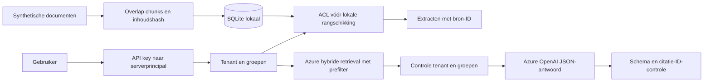

# Architectuur en afwegingen

## ADR-01: twee expliciete modi

Lokaal is een transparante trefwoordbaseline: snel, zonder account, deterministisch genoeg voor ACL-regressietests. We noemen dit geen semantische RAG. In Azure vormen embeddings en trefwoorden samen de retrieval. Het model krijgt alleen de toegestane fragmenten. Een configuratiefout laat de call falen in plaats van een fixture als echt antwoord terug te geven.

## ADR-02: autorisatie vóór retrieval

De client bepaalt nooit tenant of groepen. Een API key wordt via serverconfiguratie vertaald naar een principal. De lokale database leest eerst eigen tenant, filtert daarna groepen en berekent alleen over toegestane chunks de documentfrequenties. Zo beïnvloedt een verborgen document ook de lokale IDF-statistiek niet. Azure krijgt een ge-escapet OData-filter, `vectorFilterMode=preFilter` en een tweede controle van teruggestuurde tenant en groepen.

## ADR-03: chunks en herindexering

Lokale chunks zijn maximaal 120 woorden, met 25 woorden overlap. IDs bevatten tenant, document, inhoudshash en volgnummer. Een upsert verwijdert en vervangt alle chunks van dat document in één transactie; een rechtenwijziging werkt meteen in nieuwe queries. Reeds verzonden antwoorden zijn daarmee niet teruggenomen. Bij productie moet je ook caches en downloadbestanden afhandelen.

## ADR-04: Azure-indexbeheer blijft apart

`rag.index` maakt een demo-index en uploadt de vaste fixtures met embeddings. Het is een administratief script voor een eigen, afzonderlijke index. Het is geen algemene documentpipeline: gewijzigde of ingekorte bronbestanden kunnen oude cloudchunks achterlaten. Voor opnieuw opgebouwde fixtures maak je een nieuwe indexnaam, test je de ACL's en schakel je daarna de serverconfiguratie om. Verwijder de oude index pas na controle van retentie en rollbackbehoefte.

## Meetplan

Meet op minimaal 50 zelfgelabelde vragen: retrieval recall@4, onjuiste citaties, onterechte antwoorden versus abstention, kosten en p50/p95 latency. Laat minimaal twee beoordelaars onduidelijke gevallen bespreken. Een perfecte testscore op drie fixtures zegt niets over echte bedrijfsdocumenten. Gebruik de governance-repo voor het onderscheid tussen een controle die correct werkt en een model dat werkelijk goed presteert.
